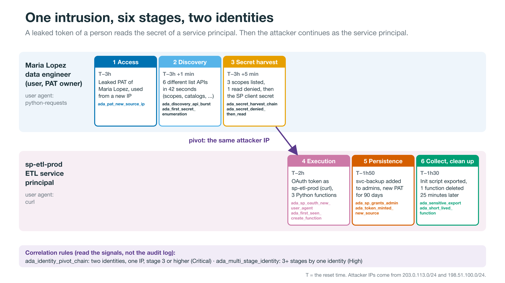
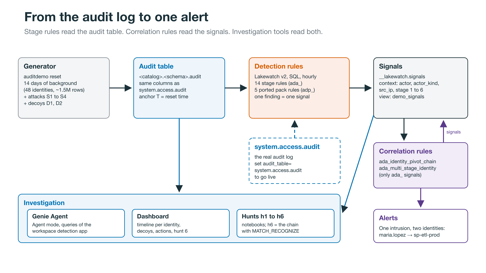
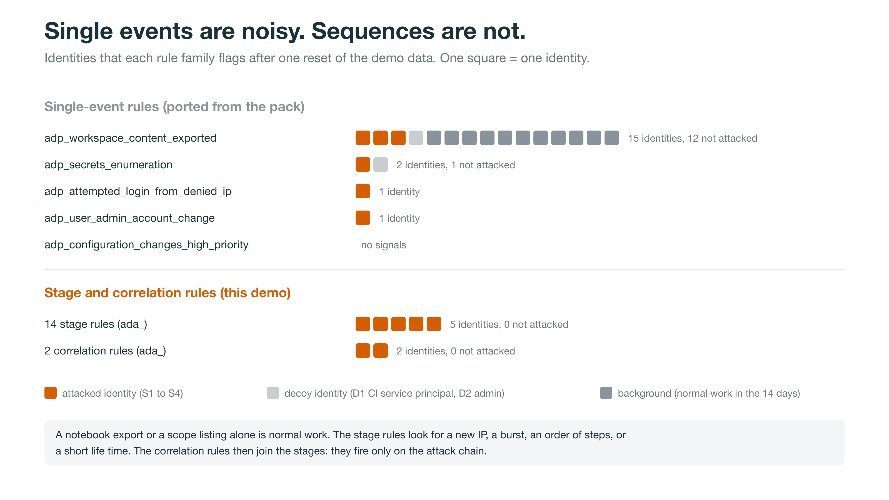

# Databricks audit log detections with Lakewatch

A [Lakewatch](https://lakewatch) example that detects credential-driven attacks on the
Databricks platform itself. It uses a synthetic copy of the `system.access.audit` table
with planted attacks, and adds detection rules, correlation rules, hunts, a Genie Agent
and an AI/BI dashboard on top of it.

The example follows the blog post
[Detecting credential-driven attacks on Databricks](https://www.databricks.com/blog/detecting-credential-driven-attacks-databricks)
and reuses the detection queries and the Genie Agent of this repository (`../genie-agent/`).

## The planted attack

A leaked personal access token (PAT) of a data engineer (Maria Lopez) is used from an attacker IP.
The attacker looks around, reads the client secret of the service principal `sp-etl-prod`, and then
continues as that service principal: Python functions, a new admin, a new token, an export of an
init script, and a deleted function. Each step alone looks like normal work. The stage rules find
the unusual steps, and the correlation rule `ada_identity_pivot_chain` joins the two identities by
the shared IP into one Critical alert.



Other scenarios: S2 a blocked replay of a stolen service principal credential (IP access list), S3 a
hijacked browser session and an export of notebooks, S4 a compute fallback after failed cluster and
job launches. Two decoys look like attacks but are normal work: D1 the nightly secret scope listing
of the CI service principal, D2 an admin who adds five new team members to a group.

### Identities and ground truth

| Identity | Who or what | Role in the data |
|----------|-------------|------------------|
| Maria Lopez (`maria.lopez@corp.example`) | Data engineer | S1: her PAT leaked; the attack starts with it |
| `sp-etl-prod` | ETL service principal | S1: the attacker reads its client secret and then acts as it. In alerts and signals it shows as its application ID `a74a1087-9084-4cf2-9c65-79b4f95ab9d5` (stable with the default seed 1337) |
| `svc-backup@corp.example` | A user | S1: added to the `admins` group (persistence) |
| Attacker IPs | `203.0.113.0/24`, `198.51.100.0/24` | Change with each reset. Maria's PAT and `sp-etl-prod` use the same IP |
| `sp-reporting` | Service principal | S2: a stolen credential, blocked by the IP access list |
| Tom Becker | Analyst | S3: his browser session is reused from another IP and browser, then notebooks are exported |
| `sp-ml-batch` | Service principal | S4: cluster and job creation fail, then it tries a SQL warehouse |
| `sp-ci-deploy` | CI service principal | Decoy D1: lists all secret scopes every night (normal) |
| Ana Silva | Admin | Decoy D2: adds five new team members to `data-eng` (normal) |

The background is 14 days and about 1.5M rows for 48 identities. Its shape (action mix, hour of
day, status codes, `request_params` keys, user agents) comes from an aggregate-only profile of a real
audit table (`profile/`). With anchor T = the reset time, the S1 attack runs from about T-3h to
T-1.5h.

## What is deployed

All objects live in one schema (default `some_catalog.databricks_audit_demo`):

| Object | Name | What it is |
|--------|------|------------|
| Table | `audit` | The synthetic copy of `system.access.audit` (same columns) |
| Table | `principals` | Display name, kind and role of each identity (for Genie and the dashboard) |
| View | `demo_signals` | The Lakewatch signals of the demo rules, with rule, stage, actor and source IP |
| Volume | `raw` | The generated parquet files |
| Lakewatch rules | `ada_*` (16), `adp_*` (5) | Detection rules; disabled except during a reset |
| Job | `databricks_audit_reset (<target>)` | Regenerates the data and runs the rules once (see [Reset](#reset)) |
| Dashboard | Databricks audit demo | Pages "Attack overview" and "Investigate" |
| Genie Agent | Databricks audit demo | Natural-language questions over the audit table and the signals (optional, `--var genie=true`) |
| Notebooks | `hunts/h1` to `h6` | Hunts; h6 finds the whole chain with `MATCH_RECOGNIZE` |



## Repository layout

| Path | What it is |
|------|------------|
| `src/auditdemo/` | Generator (background from `profile/profile.json`, scenarios S1 to S4, decoys D1 and D2), loader, rule deployment, reset flow, CLI `auditdemo` |
| `profile/` | `profile.json`: the aggregate-only profile of a real audit table that drives the background (packaged into the wheel); `profile.py`: the script that makes it; `facts.md`: verified `request_params` keys and conventions of the real table |
| `rules/` | 21 Lakewatch rules: 14 stage rules and 2 correlation rules (`ada_`), 5 rules ported from the Lakewatch `databricks_audit` content pack (`adp_`) |
| `sql/views.sql` | The `demo_signals` view (rule, stage, actor, source IP, context keys) |
| `hunts/` | Hunt notebooks h1 to h6 |
| `genie/` | Genie Agent: `build_space.py` (builds the space from `../genie-agent/`), the space file, the eval set |
| `dashboard/` | The AI/BI dashboard: builder and JSON |
| `resources/`, `resources_py/` | Bundle resources: schema, raw volume, reset job, dashboard, Genie space |
| `tools/` | `run_hunts.py` (run the hunts and check the planted entity), `genie_eval.py` (Genie eval), `try_corr_fixture.py` and `try_h6_fixture.py` (check the correlation rules and hunt 6 on small fixtures) |
| `tests/` | Unit tests (`uv run --frozen --extra dev pytest -q`) |

## Prerequisites

- A workspace with Lakewatch and a catalog that is onboarded to Lakewatch.
- A SQL warehouse. The bundle looks it up by the name `Lakewatch Warehouse`; use
  `--var warehouse_id=<id>` for another one. To find the ID, open **SQL Warehouses**, open the
  warehouse and copy the ID from its **Overview** tab (or from the URL).
- Databricks CLI with the direct deployment engine, [`uv`](https://docs.astral.sh/uv/), and Python
  3.11 or later.
- Rights to create a schema and a volume in the catalog, and to create Lakewatch rules.

## Configuration

The code uses two placeholders that you must change for your environment:

| Placeholder | What it is | Where to change it |
|-------------|------------|--------------------|
| `some-profile` | The Databricks CLI profile (in `~/.databrickscfg`) of your workspace, and the bundle target name | `targets` in `databricks.yml` (target name and `workspace.profile`); `--profile` of the `auditdemo` CLI and of the scripts in `tools/`, `dashboard/` and `profile/` |
| `some_catalog` | The Unity Catalog catalog that is onboarded to Lakewatch | `variables.catalog.default` in `databricks.yml` (or `--var catalog=<name>`); `--catalog` of the `auditdemo` CLI and the scripts |

The schema defaults to `databricks_audit_demo` (`--var schema=...` / `--schema`). The commands below
use shell variables, so set them once:

```sh
cd lakewatch
export PROFILE=<your profile> CATALOG=<your catalog> SCHEMA=databricks_audit_demo WH=<warehouse id>
```

and either edit `databricks.yml`, or replace `-t some-profile` with your target name and add
`--var catalog=$CATALOG` to the bundle commands.

## Deploy

```sh
uv sync --frozen --extra dev          # databricks-bundles and the Genie retarget mutator run from .venv
databricks bundle deploy -t some-profile            # schema, raw volume, reset job, dashboard
databricks bundle run databricks_audit_reset -t some-profile
```

The first reset creates the tables and the rules. On a new target, the first step of the reset
(disable the rules) skips the rules that do not exist yet. Then deploy the Genie Agent (the space
needs the `audit`, `principals` and `demo_signals` tables, so it can only be created after the first
reset):

```sh
databricks bundle deploy -t some-profile --var genie=true --var warehouse_id=$WH
uv run --frozen python tools/genie_eval.py --profile $PROFILE --space-id <space id>
```

`tools/genie_eval.py` asks the questions of `genie/eval.yaml` in Agent mode and prints the pass rate
(target 90%).

To use the hunts, upload the `hunts/` notebooks to the workspace (or open them from the bundle
files) and set their widgets `catalog` and `schema` to your catalog and schema.

### One-time bind (only when the schema exists already)

If `auditdemo load` or `auditdemo reset` from a laptop created the schema before the first bundle
deploy, bind the schema and the volume to the bundle before you deploy:

```sh
databricks bundle deployment bind databricks_audit_demo $CATALOG.$SCHEMA -t some-profile --auto-approve
databricks bundle deployment bind raw $CATALOG.$SCHEMA.raw -t some-profile --auto-approve
```

On a new workspace the schema does not exist yet: skip the bind.

## Reset

```sh
databricks bundle run databricks_audit_reset -t some-profile
```

The reset regenerates the data so that the attacks are recent, and takes about 11 minutes. It:

1. disables the demo rules and resolves their open alerts,
2. generates the synthetic audit table again with anchor T = now and loads it,
3. enables the stage and ported rules once (`extend_lookback` 8h) and waits for the expected signals,
4. enables the correlation rules and waits for their signals,
5. checks the scenario x rule matrix of the signals created since the start,
6. disables the rules again (also when a step fails).

The job must end with `TERMINATED SUCCESS`, and the log must end with `matrix check: no problems`.
After a reset, refresh the published dashboard (the refresh icon at the top right): the published
dashboard caches its results and otherwise shows the previous data.

Rules for resets:

- Keep resets at least 90 minutes apart. The correlation rules read the signals of the last 90
  minutes, so the pivot alert of an earlier reset can appear again. The reset prints a warning.
- Do not enable the rules by hand on the demo table: they run hourly and create alerts.
- If a reset is cancelled or fails, make sure that the rules are disabled:
  `uv run --frozen auditdemo rules --disable --profile $PROFILE --catalog $CATALOG --warehouse-id $WH`.

The same flow runs from a laptop:

```sh
uv run --frozen auditdemo reset --profile $PROFILE --catalog $CATALOG --schema $SCHEMA --warehouse-id $WH
uv run --frozen auditdemo check --since <reset start, ISO time> \
  --profile $PROFILE --catalog $CATALOG --schema $SCHEMA --warehouse-id $WH
```

`auditdemo check` prints the scenario x rule matrix for the signals created since a time.
`auditdemo try-rule <name> --anchor <ISO time>` runs the SQL of one rule for a window without
creating signals. Check the hunts with
`uv run --frozen python tools/run_hunts.py --profile $PROFILE --catalog $CATALOG --schema $SCHEMA --warehouse-id $WH`.

## What to expect after a reset

In the Lakewatch app (app switcher, the grid icon at the top right; choose the environment of your
catalog if Lakewatch asks for it), **Alerts** shows:

- one open Critical alert of `ada_identity_pivot_chain` with the title "One intrusion, two
  identities: maria.lopez@corp.example → a74a1087-9084-4cf2-9c65-79b4f95ab9d5 via 203.0.113.x" (the
  UUID is `sp-etl-prod`); its signal has `stages` = `1, 2, 3, 4, 5, 6`;
- two High alerts of `ada_multi_stage_identity` (Maria and the UUID);
- about 15 Informational alerts "Workspace content exported by ..." (the single-event noise of
  `adp_workspace_content_exported`, see [below](#why-stage-rules-and-correlation)).

A suggested walkthrough of the investigation:

1. The alert: Lakewatch → Alerts → `ada_identity_pivot_chain`, then its signals.
2. The timeline: dashboard page "Attack overview" ("Incident timeline" shows Maria Lopez and
   `sp-etl-prod` at the top, with the times of the last reset).
3. Questions in plain language: the Genie Agent in Agent mode, for example "Were we compromised?" or
   "What did the attacker do after reading secrets?".
4. The hunts: notebook `h6_staged_intrusion`.
5. The decoys: dashboard "Decoys: single-event rules fire, stage rules do not".

### Dashboard and Genie notes

- Page "Investigate": pick an identity or a source IP. With Identity = All and Source IP = All, the
  actions table shows only the newest 20,000 rows, so the attack rows can be cut off. Set Identity to
  All and pick the attacker IP to see both identities that used it.
- Use the Genie Agent in **Agent mode**: Chat mode gives shorter answers and can miss the pivot to
  `sp-etl-prod`. Time words are rolling windows that end at now ("yesterday" = the last 24 hours),
  because a reset plants the attacks just before now. When the data is older than one day, the agent
  uses the newest `event_time` as now.
- The Genie Agent and the dashboard read the demo table, not `system.access.audit`.

## Why stage rules and correlation



The single-event rules of the content pack fire on normal work: `adp_workspace_content_exported`
flagged 15 identities in the reset of the figure, and 12 of them were not attacked (11 background
identities and a decoy; the background part changes a little with each reset).
`adp_secrets_enumeration` flags the nightly CI job. The stage rules look for a new IP, a burst, an
order of steps or a short life time, and they fire only on the attacked identities. The correlation
rules then join the stages.

## Genie Agent

The Genie Agent is built from the Genie Agent of this repository (`../genie-agent/`).
`genie/build_space.py` calls its build (`genie-agent/deploy/install.py`), points it at the demo
table, drops the two detections that read `system.query.history`, and adds the `principals` table,
the `demo_signals` view, two example queries (identity and shared-IP timeline, "what did the
attacker do after reading secrets?") and a paragraph about the demo. Rebuild after a change to
`../genie-agent/` or to `build_space.py`:

```sh
uv run --frozen python genie/build_space.py
```

The tests fail when the space file is out of date. The space file uses the placeholder
`audit_demo_catalog.audit_demo`; at deploy time the
[`pydabs-genie-agent-retarget`](https://github.com/alexott/pydabs-genie-agent-retarget) bundle
mutator rewrites it to `${var.catalog}.${var.schema}`.

## Development checks

- Unit tests: `uv run --frozen --extra dev pytest -q`.
- After a change to a correlation rule:
  `uv run --frozen python tools/try_corr_fixture.py --profile $PROFILE --catalog $CATALOG --warehouse-id $WH`.
  It runs the rules over a small fixture of signals (with duplicates, decoys, near misses and the
  signals of a previous reset).
- After a change to hunt 6:
  `uv run --frozen python tools/try_h6_fixture.py --profile $PROFILE --warehouse-id $WH`. It runs 6a
  and 6b on small test rows, not on the demo tables. 6a must find three harvest orders (all lists
  before all reads, one scope at a time, the scopes listed again in the middle) and must not find
  three near misses (5 calls of only one discovery kind, no successful read, the reads 31 minutes
  after the login: the pattern allows 30 minutes).
- To profile your own audit table for the background generator:
  `uv run --frozen python profile/profile.py --profile $PROFILE --workspaces 2 --days 7` (aggregate
  queries only; no identities, IPs, IDs or parameter values are written).

## Troubleshooting

| Problem | What to do |
|---------|------------|
| The reset job failed | Disable the rules (`auditdemo rules --disable ...`), look at the job log, and run the reset again. |
| The reset prints `MATRIX PROBLEM` | A rule did not fire as expected. Run it alone with `auditdemo try-rule <name> --anchor <reset start>`. |
| No pivot alert | Look in the reset log for `MATRIX PROBLEM` on `ada_identity_pivot_chain`. Check that the correlation rules were applied after the signals of the stage rules ("waiting for the signals of ... stage and ported rule(s)" comes before the correlation rules). |
| Two pivot alerts with different IPs | One is from an earlier reset (resets less than 90 minutes apart). Use the one with the newest time. |
| The dashboard shows old times | Click the refresh icon at the top right: the published dashboard caches its results. |
| The dashboard is slow | The SQL warehouse may be starting. Wait one minute. |
| The actions table has no attack rows | Pick an identity or the attacker IP in the filters (All/All shows only the newest 20,000 rows). |
| Genie gives a short or wrong answer | Check that Agent mode is on, and start a new chat. |
| The rules are enabled between resets | `uv run --frozen auditdemo rules --disable --profile $PROFILE --catalog $CATALOG --warehouse-id $WH` |

## Teardown

```sh
uv run --frozen auditdemo teardown --profile $PROFILE --catalog $CATALOG --warehouse-id $WH   # deletes only the ada_*/adp_* rules of the schema
databricks bundle destroy -t some-profile
```

The Lakewatch rules have no bundle resource yet (REST only), so delete them before
`bundle destroy`.

## Running the rules on the real audit log

Read this first: `ada_sp_oauth_new_user_agent` was too slow on a real `system.access.audit`. Keep it
out (`--exclude`), or narrow its baseline before you enable it on a schedule.

Apply the rules to the real table and enable them on their hourly schedule, without
`ada_sp_oauth_new_user_agent`:

```sh
uv run --frozen auditdemo rules --audit-table system.access.audit --enable \
  --exclude ada_sp_oauth_new_user_agent --profile $PROFILE --catalog $CATALOG --warehouse-id $WH
```

`--exclude NAME[,NAME]` does not create or change these rules. A rule that exists keeps its state:
after a reset all rules are disabled, so the excluded rule stays disabled. The `rules` command does
not wait for signals. (`--wait` waits for the signals that the scenarios expect; use it only with
the demo table.)

In the bundle, the variable `audit_table` does the same for the reset job
(`--var audit_table=system.access.audit`): the reset still loads the demo table, runs the rules once
on the real table and disables them again. A reset always leaves the rules disabled, so do not run a
reset on a schema whose rules must stay live.

The stage and ported rules read only `{{audit_table}}`; the correlation rules read only the signals.
Known limits:

- `ada_sp_oauth_new_user_agent` is slow on the real table (see above).
- The Genie Agent and the dashboard read the demo table, not `system.access.audit`.
- The correlation rules see only the signals that were created in the last 90 minutes. On an hourly
  schedule, the pivot alert is missed when the stage signals of the two identities are created more
  than 90 minutes apart.
- The baselines (14 days, "first time seen") were tuned on the synthetic background. Real data has
  more automation and needs narrower baselines (per workspace, per known CI identity).
- The reset and its matrix check only make sense on the demo table.

## Possible extensions

- Time adjacency as a correlation rule: a new user agent of a service principal soon after a secret
  read, without a shared IP (hunt h5 does it today). It works when the attacker rotates IPs.
- `MATCH_RECOGNIZE` as a scheduled job that writes a table, plus a v2 rule over that table (the rule
  API does not accept `MATCH_RECOGNIZE`).
- `system.access.inbound_network` for context-based ingress denials (the blog mentions it).
- Narrower baselines for real data (see the known limits above).
- A correlation window that does not depend on `created_at` (the 90-minute limit).
